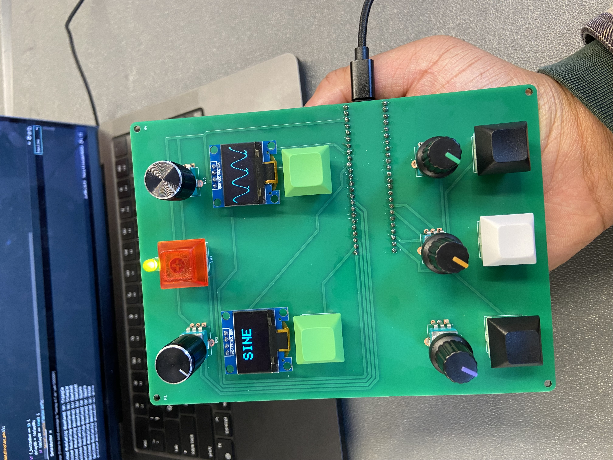

# Intergalactic-AX11: A Cosmic Ring Modulator

Life feels so bustling these days. When's the last time you’ve looked up in the sky and just got lost? Wondering who and what immaculate worlds are just waiting too, staring back at you. Could you imagine what you would hear if you were ever able to get there? Well, with Intergalatic, you at least have a shot. Intergalatic is a ring modulator whose sole purpose is to blast you on a new sonic adventure and help redefine what it means to be amongst the stars. You can plug in your samples or your guitar and take a hypersonic trip without needing to leave your bedroom.

Send your sounds to space!

[intergalactic schematic](</docs/schematic + PCB/intergalactic schematic.pdf>)

[intergalactic PCB](</docs/schematic + PCB/intergalactic PCBc.pdf>)

## Technical Specifications

* **Microcontroller:** Teensy 4.1 (NXP i.MXRT1062, 32-Bit ARM Cortex-M7)
* **Audio CODEC:** SGTL5000 Audio Shield ($24\text{-bit} / 44.1\text{ kHz}$ I2S I/O)
* **Target Latency:** $< 1.5\text{ ms}$ (buffer size: 128 samples)
* **Components:** 6x Clicky Pushbuttons, 5x Potentiometers, 2x OLED Screens, 1x LED
* **I/O Options:** Dual-channel 3.5mm Stereo Jack, Line Out pads, and Class-Compliant USB Audio Interface for Ableton Live / DAW integration.

---
## Hardware Setup & Build Instructions

### Prerequisites
* [Arduino IDE](https://www.arduino.cc/en/software) with [Teensyduino add-on installed](https://www.pjrc.com/teensy/td_download.html).

### IDE Configuration
1. Connect Teensy 4.1 via Micro-USB.
2. Select **Board:** `Teensy 4.1`.
3. Select **USB Type:** `Audio` (or `Serial + MIDI + Audio`).
4. Set **CPU Speed:** `600 MHz`.
5. Compile and flash `src/main.cpp`.
---
## Audio Signal Architecture

1. **Solar Flare (Ring Modulator):** Multiplies audio input with an array of carrier waveforms (Sine, Sawtooth, Triangle, Square, Pulse, Sample & Hold) switched via software-debounced hardware button.
2. **Space Dust (Low-Pass Filter):** Dynamic high-end frequency reduction above 4500 Hz for chaotic cosmic control.
3. **Gravity Drift (Modulated Delay):** Variable read-pointer delay buffer with exponential moving average (EMA) parameter smoothing and a low-pass filtered feedback loop for analog tape warble without digital zipper noise.
---
## Watch and hear how it works!

